# Визуальная архитектура Meta-токенов, n8n и MediaHave

> Последовательная русскоязычная визуализация документа
> [`meta-token-n8n-architecture.md`](./meta-token-n8n-architecture.md).
>
> Mermaid-блоки ниже отображаются в GitHub как диаграммы. Значения токенов,
> ключей и других секретов намеренно не приводятся.

## Готовые визуальные материалы

Файлы лежат в [`docs/assets/meta-architecture/`](./assets/meta-architecture/):

| Формат | Файл |
|---|---|
| Презентация PowerPoint | [`meta-token-n8n-architecture-ru.pptx`](./assets/meta-architecture/meta-token-n8n-architecture-ru.pptx) |
| HTML-презентация | [`meta-token-n8n-architecture-ru.html`](./assets/meta-architecture/meta-token-n8n-architecture-ru.html) |
| PNG / JPEG схемы | `01` … `07` в той же папке |

Пересоздать материалы:

```bash
python3 scripts/generate_meta_architecture_visuals.py
```

### Превью схем

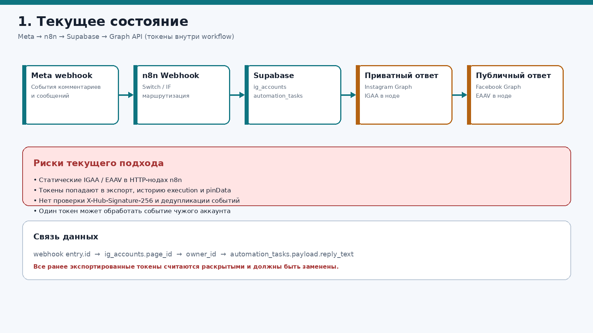

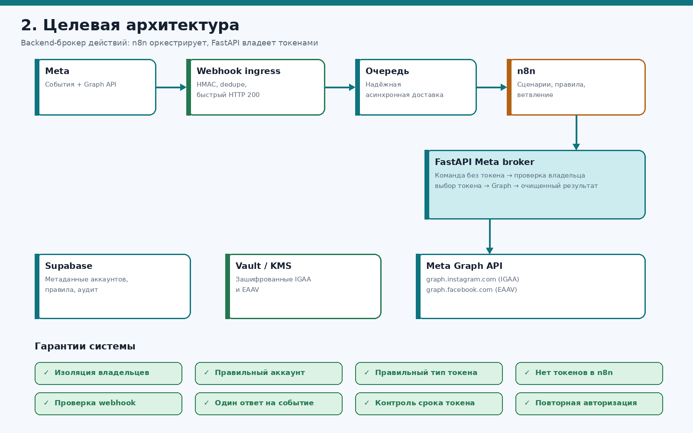

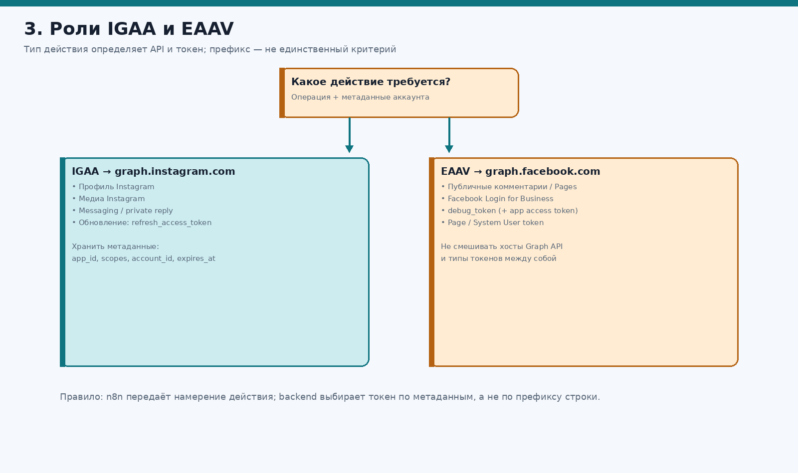

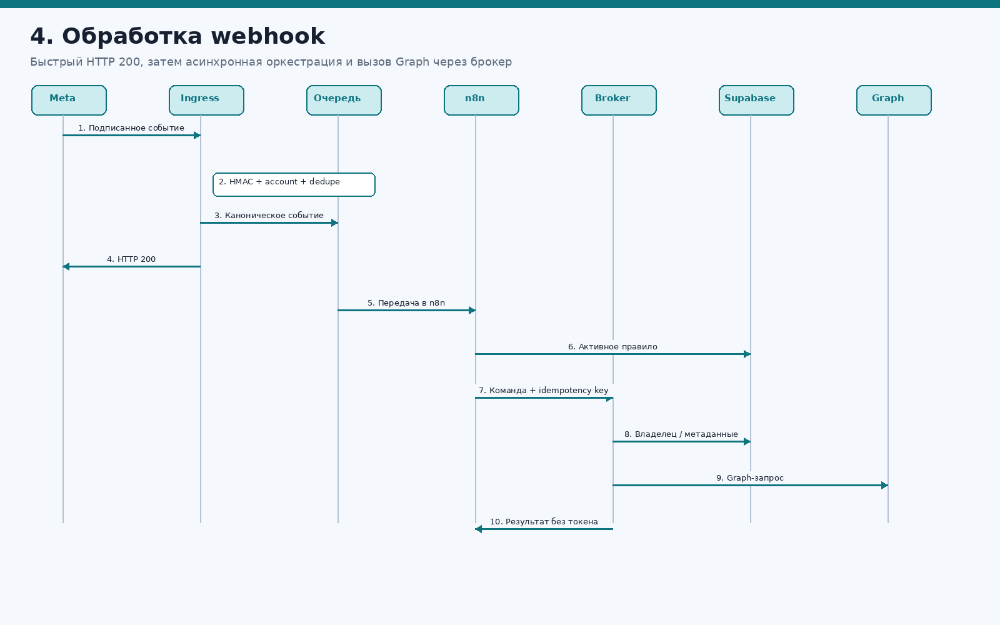

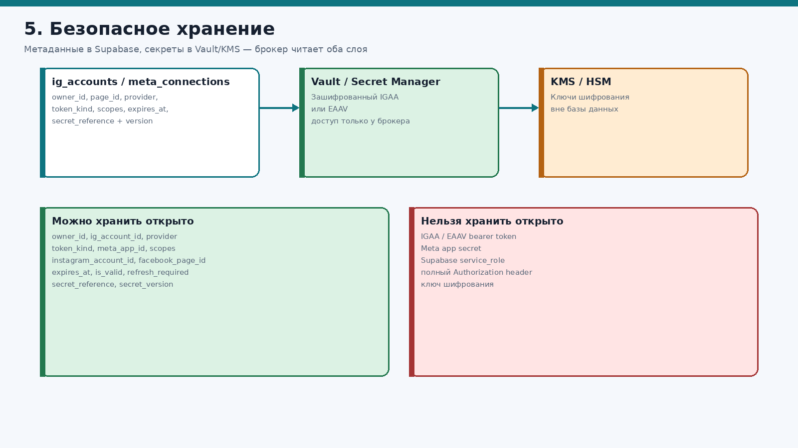

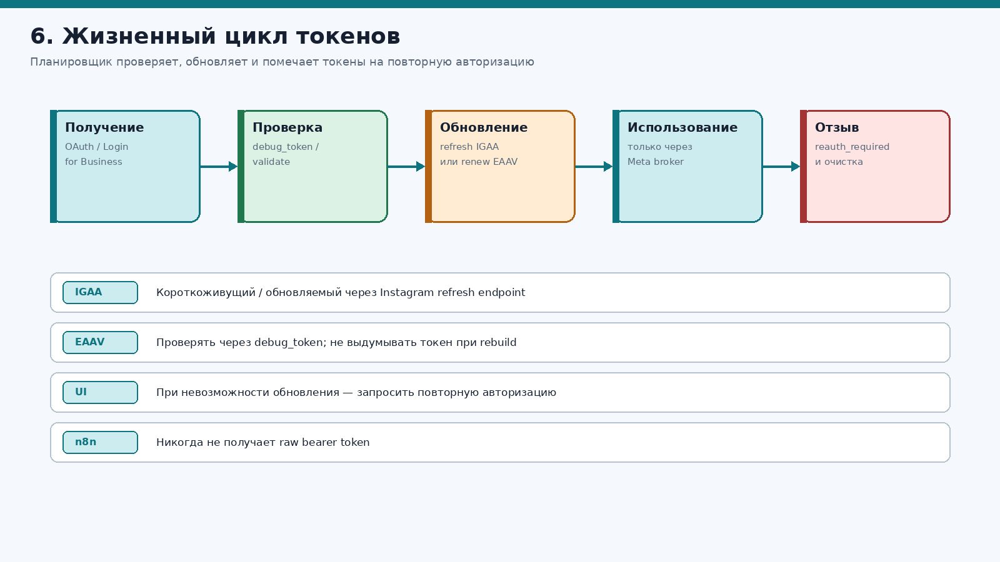

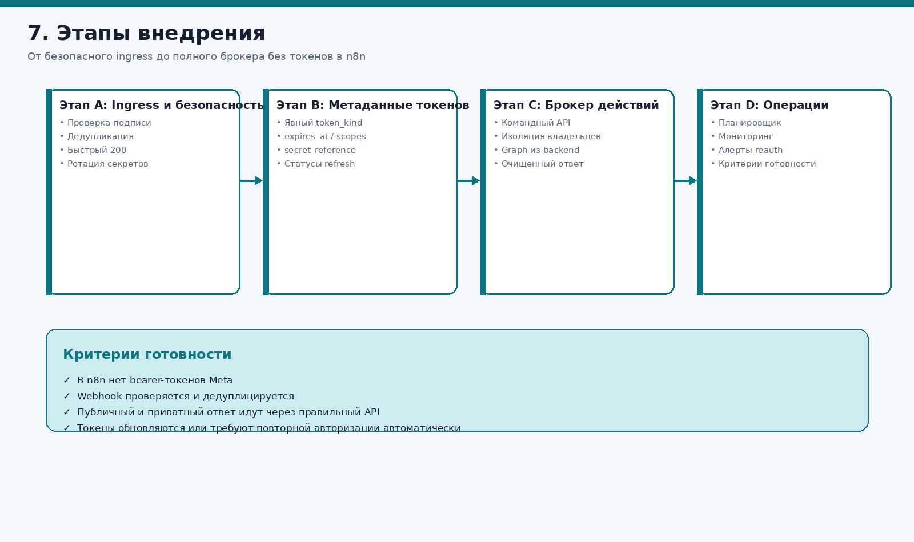

## Навигация

1. [Текущее состояние](#1-текущее-состояние)
2. [Проблема](#2-проблема)
3. [Цель](#3-цель)
4. [Роли IGAA и EAAV](#4-роли-igaa-и-eaav)
5. [Целевая архитектура](#5-целевая-архитектура)
6. [Обработка webhook](#6-обработка-webhook)
7. [Безопасное хранение](#7-безопасное-хранение)
8. [Backend-брокер действий](#8-backend-брокер-действий)
9. [Жизненный цикл токенов](#9-жизненный-цикл-токенов)
10. [Целевой workflow n8n](#10-целевой-workflow-n8n)
11. [Варианты реализации](#11-варианты-реализации)
12. [Этапы внедрения](#12-этапы-внедрения)
13. [Тестирование и мониторинг](#13-тестирование-и-мониторинг)
14. [Критерии готовности](#14-критерии-готовности)

---

## 1. Текущее состояние

В текущем экспортированном workflow `mary-fitness` события Meta напрямую
поступают в n8n. Workflow самостоятельно читает Supabase и вызывает Graph API.

### Схема 1 — существующий поток

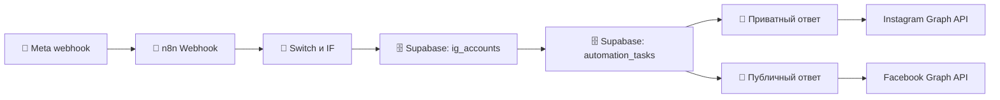

Связь данных:

```text
webhook entry.id
  → ig_accounts.page_id
  → ig_accounts.owner_id
  → automation_tasks.owner_id
  → automation_tasks.payload.reply_text
```

### Что хранится прямо в workflow

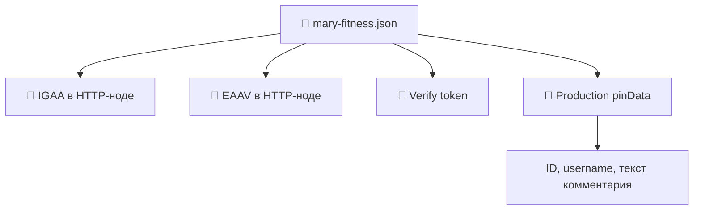

Все токены и секреты, которые ранее попадали в экспорт, сообщения, скриншоты
или журналы, необходимо считать раскрытыми и заменить.

---

## 2. Проблема

### Схема 2 — основные риски

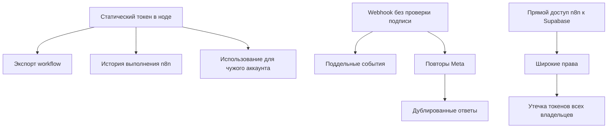

Критические недостатки:

- токен не связан с конкретным `entry.id`;
- один статический токен может обрабатывать события другого владельца;
- подпись `X-Hub-Signature-256` не проверяется;
- нет дедупликации событий;
- обрабатывается только первый элемент массива Meta;
- webhook может не получить быстрый HTTP 200;
- ошибки OAuth, rate limit и Graph 5xx не классифицируются;
- n8n может сохранить Authorization header в execution data.

---

## 3. Цель

Создать единый безопасный контур, в котором n8n управляет сценарием, а backend
управляет идентификацией, авторизацией, токенами и Graph API.

### Схема 3 — ожидаемый результат

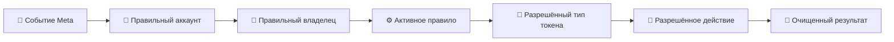

Система должна гарантировать:

1. Изоляцию владельцев.
2. Выбор правильного аккаунта.
3. Выбор правильного типа токена.
4. Отсутствие токенов в n8n.
5. Проверку подлинности webhook.
6. Один ответ на одно событие.
7. Автоматический контроль срока действия.
8. Повторную авторизацию при невозможности обновления.

---

## 4. Роли IGAA и EAAV

Префикс токена не должен быть единственным критерием выбора. В базе необходимо
хранить явные метаданные провайдера, типа токена, приложения, разрешений и
активов.

### Схема 4 — выбор токена

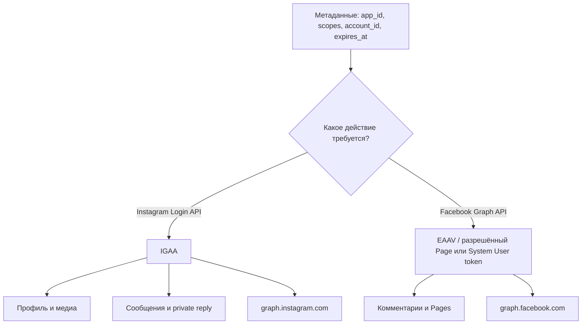

### Таблица назначения

| Операция | API | Токен |
|---|---|---|
| Профиль Instagram | `graph.instagram.com` | IGAA |
| Медиа Instagram | `graph.instagram.com` | IGAA |
| Instagram messaging | `graph.instagram.com` | IGAA |
| Публичный ответ через Facebook Login | `graph.facebook.com` | EAAV |
| Проверка EAAV | `graph.facebook.com/debug_token` | EAAV + app access token |
| Обновление IGAA | `graph.instagram.com/refresh_access_token` | действующий IGAA |

---

## 5. Целевая архитектура

Рекомендуемый вариант — **backend-брокер действий**. n8n не получает bearer
token. Он передаёт backend команду, а backend сам вызывает Meta.

### Схема 5 — общая архитектура

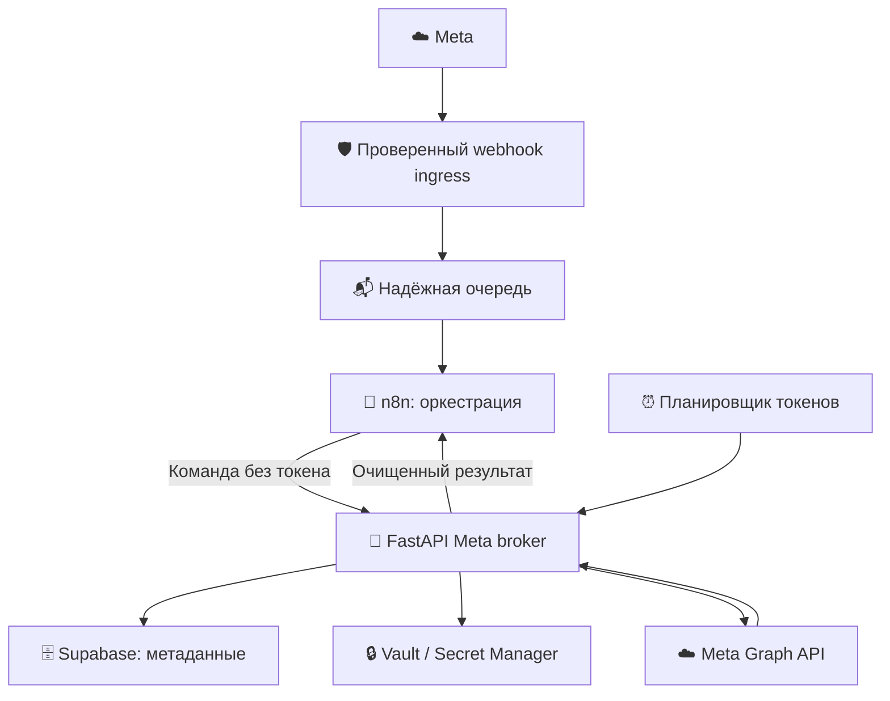

### Разделение ответственности

| Компонент | Ответственность |
|---|---|
| Meta | Отправка событий и выполнение Graph API |
| Webhook ingress | Проверка подписи, дедупликация, быстрый HTTP 200 |
| Очередь | Надёжная асинхронная доставка |
| n8n | Ветвление, правила, расписание, обработка результатов |
| FastAPI broker | Проверка владельца, выбор токена, Graph-запрос |
| Supabase | Аккаунты, правила, статусы и аудит |
| Vault/KMS | Зашифрованные значения токенов |

---

## 6. Обработка webhook

Meta должна получить ответ быстро. Graph API и Supabase-запросы не должны
удерживать публичный webhook открытым.

### Схема 6 — последовательность

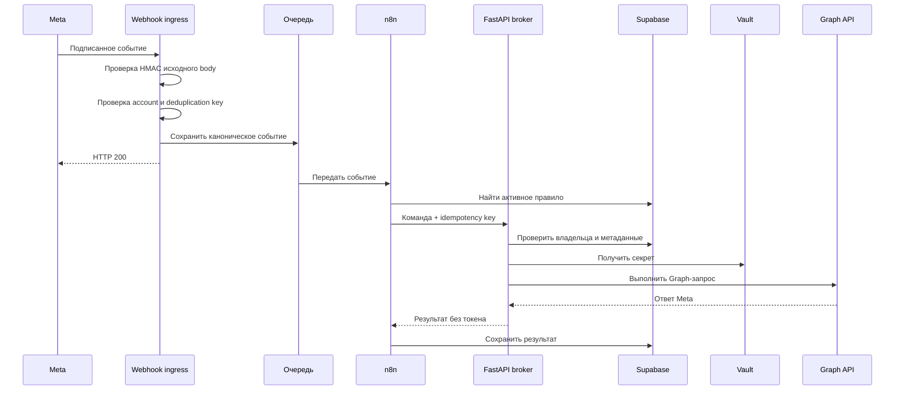

### Правила ingress

1. Использовать точные исходные байты request body.
2. Проверять `X-Hub-Signature-256`.
3. Сравнивать HMAC в constant time.
4. Проверять известный `entry.id`.
5. Обрабатывать все `entry`, `changes` и `messaging`.
6. Формировать стабильный ключ дедупликации.
7. Сохранять событие до асинхронной обработки.
8. Отвечать HTTP 200 до выполнения Graph-запросов.

---

## 7. Безопасное хранение

### Схема 7 — слои хранения

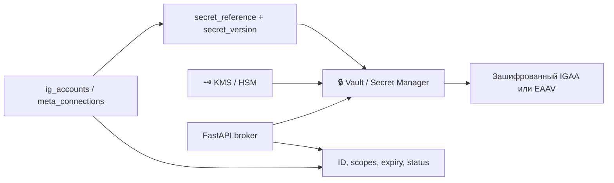

### Что можно хранить открыто

```text
owner_id
ig_account_id
provider
token_kind
meta_app_id
instagram_account_id
facebook_page_id
scopes
expires_at
data_access_expires_at
is_valid
refresh_required
last_checked_at
secret_reference
secret_version
```

### Что нельзя хранить открыто

```text
IGAA bearer token
EAAV bearer token
Meta app secret
Supabase service_role
полный Authorization header
ключ шифрования
```

### Рекомендуемая модель таблицы

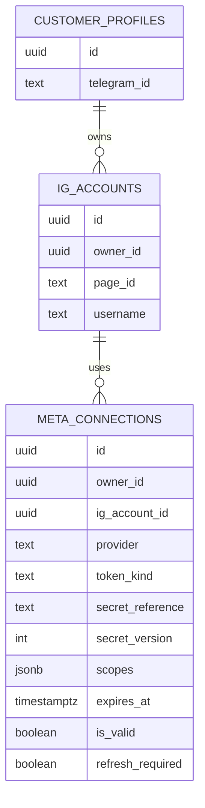

Если внешний менеджер секретов пока недоступен, временный вариант:

1. Шифровать токен в FastAPI до записи.
2. Хранить ключ вне Supabase.
3. Хранить версию ключа рядом с ciphertext.
4. Расшифровывать только внутри брокера.
5. Не возвращать токен через status/account API.

---

## 8. Backend-брокер действий

n8n должен передавать намерение выполнить действие, а не запрашивать токен.

### Схема 8 — проверка команды

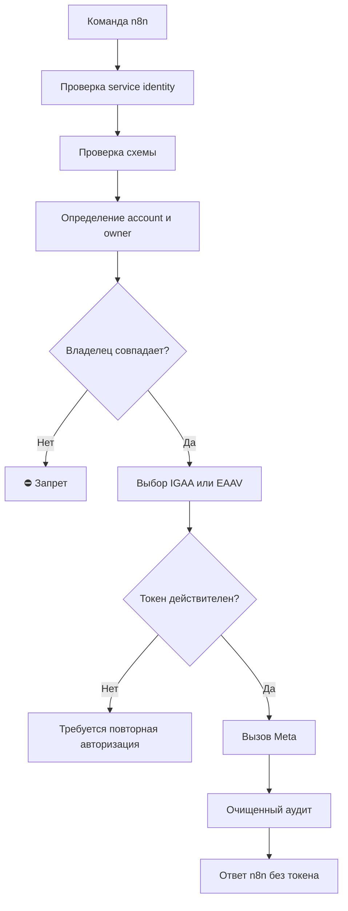

### Пример команды

```http
POST /api/internal/meta/actions
Authorization: Bearer <N8N_SERVICE_TOKEN>
```

```json
{
  "operation": "public_comment_reply",
  "instagram_account_id": "account-id",
  "target_id": "comment-id",
  "message": "Текст ответа",
  "event_id": "meta-event-id",
  "idempotency_key": "comment:automation:public-reply"
}
```

Backend обязан:

1. Проверить n8n service credential.
2. Проверить схему команды.
3. Найти одну активную строку аккаунта.
4. Проверить владельца.
5. Проверить активное правило.
6. Выбрать правильный token kind.
7. Проверить срок и scopes.
8. Выполнить Graph API.
9. Записать аудит без секрета.
10. Вернуть стабильный результат.

---

## 9. Жизненный цикл токенов

Проверки только при открытии Telegram Mini App недостаточно. Нужен ежедневный
планировщик.

### Схема 9 — состояния токена

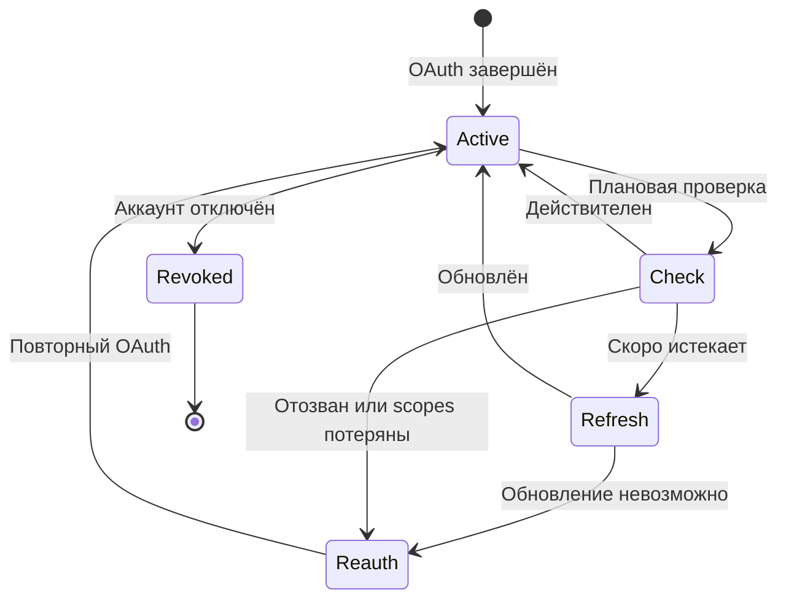

### Когда запускать проверку

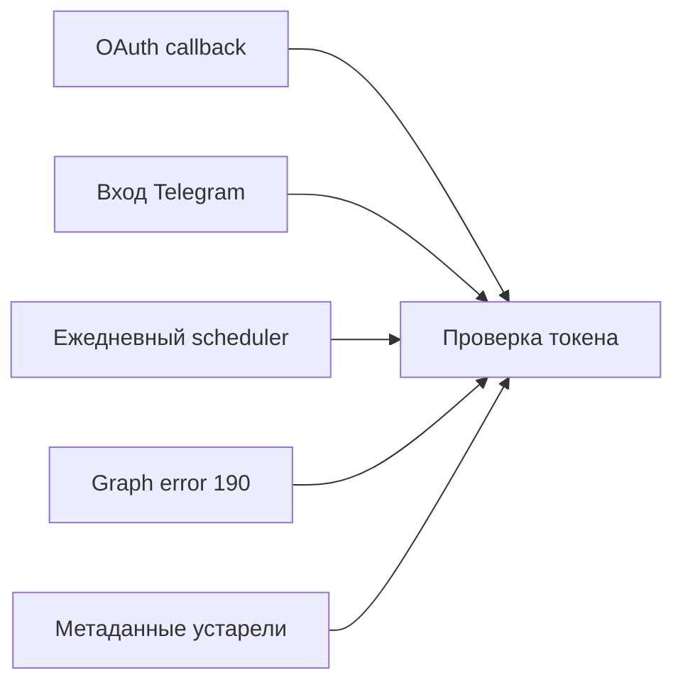

### IGAA

- записать срок действия при OAuth;
- обновлять через поддерживаемый Instagram refresh endpoint;
- обновлять до истечения;
- проверять соответствие ожидаемому Instagram account ID;
- при невозможности обновления требовать повторный OAuth.

### EAAV

- определить User, Page или System User token;
- проверять `app_id`, scopes и assets;
- учитывать отдельный срок data access;
- обменивать только поддерживаемые типы;
- не пытаться автоматизировать Graph API Explorer;
- при отзыве разрешений требовать повторную авторизацию.

Для защиты от параллельного обновления нужен distributed lock.

---

## 10. Целевой workflow n8n

### Схема 10 — новый pipeline

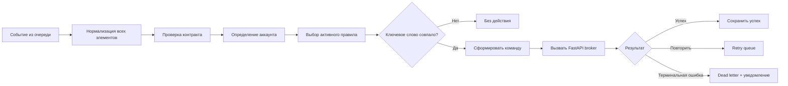

### Удалить из `mary-fitness`

- literal IGAA;
- literal EAAV;
- hardcoded webhook verification secret;
- production pinData;
- прямые Graph-запросы со статическим токеном;
- `Content-Type:` из body parameters.

### Добавить

- быстрый webhook acknowledgment;
- обработку всех элементов batch;
- canonical event;
- deduplication key;
- account resolution;
- deterministic active rule;
- нормализованное сравнение ключевого слова;
- вызов backend broker;
- retry и dead-letter ветки;
- redacted action result.

---

## 11. Варианты реализации

### Схема 11 — дерево решений

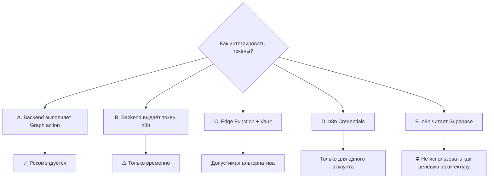

### Сравнение

| Вариант | Безопасность | Multi-tenant | Сложность | Статус |
|---|---:|---:|---:|---|
| Backend action broker | Высокая | Да | Средняя | Рекомендуется |
| Backend возвращает токен | Средняя | Да | Средняя | Временный этап |
| Edge Function + Vault | Высокая | Да | Высокая | Альтернатива |
| n8n Credentials | Средняя | Нет/ограниченно | Низкая | Один аккаунт |
| Прямой Supabase lookup | Низкая | Опасно | Низкая | Не рекомендуется |

---

## 12. Этапы внедрения

### Схема 12 — дорожная карта

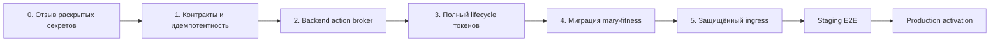

### Фаза 0 — немедленно

- отозвать раскрытые IGAA и EAAV;
- заменить verify token;
- удалить production pinData;
- ограничить доступ к n8n;
- оставить workflow выключенным.

### Фаза 1 — контракты

- canonical Meta event;
- versioned automation payload;
- одна активная автоматизация на account/keyword;
- таблица idempotency/action attempts;
- ссылки на секреты вместо plaintext.

### Фаза 2 — broker

- отдельная аутентификация n8n;
- внутренний action endpoint;
- account/owner/target validation;
- Graph clients;
- error classification;
- redacted audit.

### Фаза 3 — lifecycle

- IGAA refresh;
- scheduler для EAAV;
- distributed locks;
- предупреждения 7/3/1 день;
- reauthorization status;
- очистка токенов при disconnect.

### Фаза 4 — n8n

- sanitized staging workflow;
- замена Graph-нод на broker;
- исправление routing;
- retry/DLQ;
- сквозные тесты;
- активация после проверки.

### Фаза 5 — ingress

- один публичный webhook;
- raw-body HMAC verification;
- очередь;
- отключение дублирующего ingress.

---

## 13. Тестирование и мониторинг

### Схема 13 — контур качества

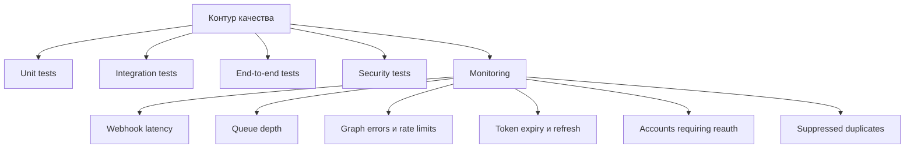

### Обязательные сценарии

- публичный ответ на комментарий;
- private reply;
- входящий и исходящий DM;
- два владельца с разными аккаунтами;
- одинаковый текст комментария от разных пользователей;
- batch с несколькими `entry`;
- повтор одного webhook;
- истёкший IGAA;
- отозванный EAAV;
- потерянное разрешение;
- Graph 429;
- Graph 5xx;
- timeout.

### Что записывать в журнал

```text
internal account ID
owner ID
operation
event ID
idempotency key
token kind
secret version
Graph status/error code
retry decision
latency
```

### Что не записывать

```text
bearer token
app secret
service_role
Authorization header
ключ шифрования
```

---

## 14. Критерии готовности

### Схема 14 — проверка допуска в production

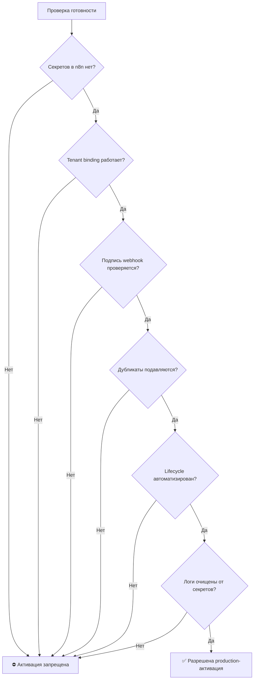

Финальные критерии:

1. В workflow JSON нет IGAA, EAAV, app secret, verify token или Supabase secret.
2. n8n не может прочитать plaintext-токены.
3. Каждое действие связано с одним владельцем и аккаунтом.
4. Повтор события не создаёт повторный ответ.
5. Подпись webhook проверяется.
6. Meta быстро получает HTTP 200.
7. IGAA и EAAV обслуживаются независимо.
8. Отозванный токен останавливает отправку.
9. Ротация не требует изменения workflow.
10. Execution data не содержит Authorization.

---

## 15. Итоговое решение

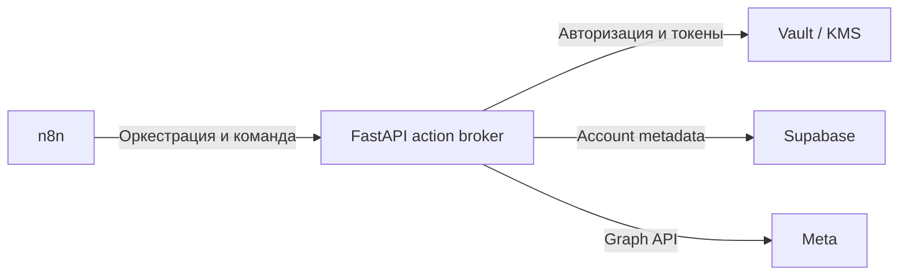

**Решение:** использовать n8n для оркестрации, ветвления и расписания, а
FastAPI — для идентификации, авторизации, lifecycle токенов, доступа к секретам
и выполнения Graph API.

Такое разделение сохраняет workflow понятным и одновременно защищает
multi-tenant данные и Meta-токены.

## Связанные документы

- [Полное архитектурное описание на английском](./meta-token-n8n-architecture.md)
- [Восстановление `git pull` на production-сервере](./server-git-pull-recovery.md)
