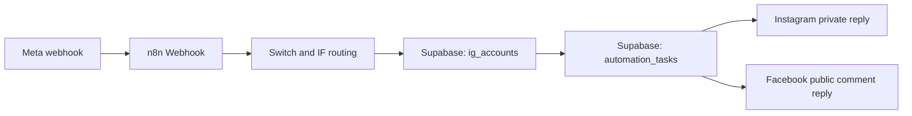
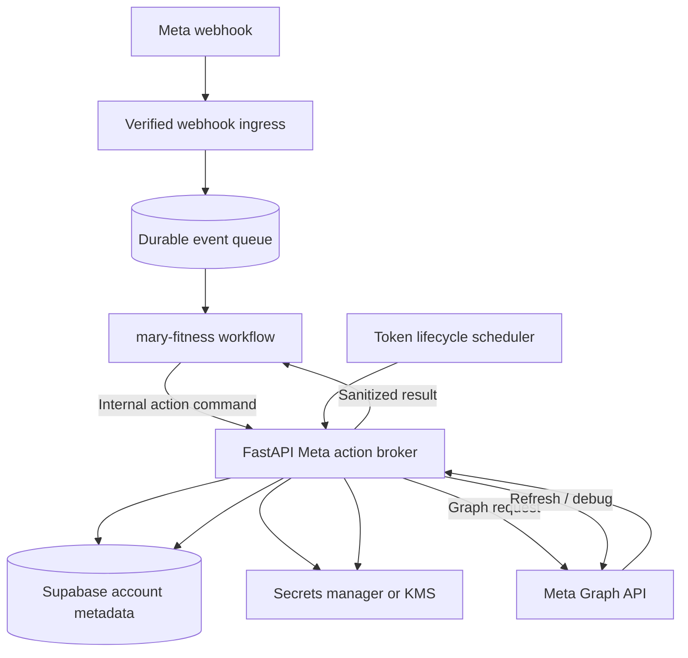
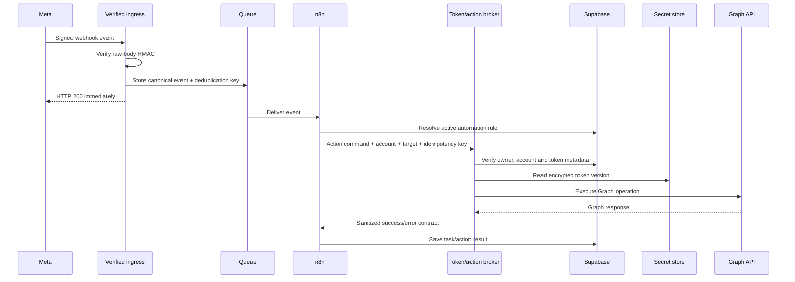
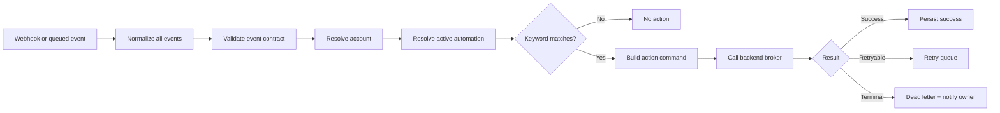

# Professional Meta Token Integration for `instagram-bot-app` and `mary-fitness`

## Document status

- Scope: architecture and implementation plan only.
- Application code changed by this task: **none**.
- Source reviewed:
  `/home/ubuntu/.cursor/projects/workspace/uploads/mary-fitness_f7ff.json`.
- Secrets are intentionally omitted from this document.

The uploaded workflow export contains live-looking IGAA and EAAV bearer tokens,
a webhook verification secret, and pinned production webhook data. Treat all
secrets contained in that export as compromised, revoke them, and remove the
pinned data before sharing or storing another workflow export.

## 1. Task

Design a professional integration between:

1. The `instagram-bot-app` FastAPI backend.
2. Supabase account and automation data.
3. The `mary-fitness` n8n workflow.
4. Meta Instagram/Facebook Graph APIs.
5. IGAA Instagram Login tokens.
6. EAAV Facebook Login tokens.

The integration must support multiple MediaHave users and Instagram accounts
without embedding tokens in workflow nodes, exports, execution logs, frontend
code, or automation payloads.

## 2. Goal

Create one secure control plane for OAuth credentials and one reliable execution
path for Instagram automation.

The target system must:

- associate every webhook event with the correct `ig_accounts` row;
- select the correct token type for each Graph operation;
- prevent one tenant from using another tenant's token or automation rule;
- refresh or reauthorize tokens before they become unusable;
- keep raw bearer tokens outside n8n workflow definitions;
- verify webhook authenticity;
- acknowledge Meta webhook requests quickly;
- prevent duplicate replies when Meta retries a webhook;
- classify retryable and terminal Graph errors;
- provide operational visibility without logging secrets.

## 3. Current state

The uploaded `mary-fitness` workflow contains approximately 40 nodes and is
currently marked inactive.

Its relevant data path is:



The workflow currently couples data as follows:

```text
webhook entry.id
  → ig_accounts.page_id
  → ig_accounts.owner_id
  → automation_tasks.owner_id
  → automation_tasks.payload.reply_text
```

### Current token use

- `Send a Private Reply to a Commenter` embeds an IGAA token directly.
- `HTTP Request3` embeds an EAAV token directly.
- Neither request selects its token from the resolved Instagram account.
- The Supabase `ig_accounts` node resolves the owner but does not supply a
  securely managed token.

### Current workflow defects relevant to this project

1. Meta tokens are stored directly in node parameters.
2. Exporting the workflow exports the tokens.
3. n8n execution data may retain request headers and errors.
4. The same static token can be used for events belonging to another account.
5. Webhook POST signatures are not verified.
6. Only the first `entry`, `change`, or `messaging` element is processed.
7. There is no idempotency or duplicate-event protection.
8. Graph API retry, rate-limit, and terminal OAuth errors are not classified.
9. `Content-Type:` is incorrectly configured as a request body parameter in the
   public reply node.
10. The private-reply URL contains trailing whitespace.
11. The comment-matching Code node is disconnected.
12. A normal POST event does not reliably reach `Respond to Webhook`, although
    Meta expects a fast success response.

## 4. Existing application token model

The application currently stores two token families in `ig_accounts`.

| Token | Current column | Purpose |
|---|---|---|
| IGAA | `access_token` | Instagram Login APIs |
| EAAV | `facebook_access_token` | Facebook Graph APIs |

EAAV metadata already includes:

- `facebook_user_id`;
- `facebook_token_expires_at`;
- `facebook_data_access_expires_at`;
- `facebook_token_scopes`;
- `facebook_token_is_valid`;
- `facebook_token_refresh_required`;
- `facebook_token_last_checked_at`;
- `facebook_token_error`.

The backend currently:

- obtains IGAA through Instagram OAuth;
- obtains EAAV through Facebook OAuth;
- validates EAAV with `debug_token`;
- checks EAAV during Telegram authentication;
- attempts a supported token exchange before explicit expiry;
- flags user reauthorization when token or data access cannot be renewed.

### Existing gaps

- Both token columns are plaintext.
- IGAA has no refresh service.
- EAAV checks occur primarily during Telegram login instead of a scheduler.
- Disconnecting an account does not erase token values.
- Legacy `customer_profiles.instagram_access_token` duplicates IGAA.
- The frontend Facebook authorization action is temporarily disabled.
- n8n does not consume the application's lifecycle state.

## 5. Recommended architecture

Use the backend as a **Meta action and token broker**.

n8n should request an action, not request a bearer token. The backend should
resolve the account, decrypt the token, call Meta, and return a sanitized result.



### Why this is the recommended design

1. **Tokens never enter n8n.**
   They are absent from workflow definitions, exports, node input/output, and
   execution history.

2. **Account binding is enforced centrally.**
   The backend verifies that the webhook account, owner, automation task, token,
   and requested Graph target belong to one tenant.

3. **OAuth logic remains in one system.**
   n8n does not need Meta app secrets, refresh logic, or token-class knowledge.

4. **Graph errors are normalized.**
   The backend can distinguish retryable rate limits and 5xx errors from expired
   tokens, missing permissions, and invalid targets.

5. **Token rotation does not require editing a workflow.**
   n8n calls the same internal action endpoint after every rotation.

6. **The approach scales to multiple accounts.**
   Static n8n credentials are not suitable for dynamically selecting hundreds
   of per-customer tokens.

## 6. Proposed end-to-end event flow



## 7. Token selection rules

Token and endpoint must be selected as one validated pair.

| Operation | Endpoint family | Token |
|---|---|---|
| Instagram profile/media read | `graph.instagram.com` | IGAA |
| Instagram messaging/private reply supported by Instagram Login | `graph.instagram.com` | IGAA |
| Facebook Login comment lookup/reply | `graph.facebook.com` | EAAV or the validated Page/System User token required by the integration |
| IGAA refresh | `graph.instagram.com/refresh_access_token` | Existing valid IGAA |
| EAAV debug | `graph.facebook.com/debug_token` | EAAV plus app access token |

Never determine token type only from its prefix. Store explicit metadata:

```text
provider
token_kind
meta_app_id
instagram_account_id
facebook_page_id
scopes
issued_at
expires_at
data_access_expires_at
refresh_supported
secret_version
status
```

## 8. Professional secret storage

### Recommended model

```text
ig_accounts / meta_connections
  → secret reference and non-secret metadata

Secrets manager
  → encrypted IGAA and EAAV versions

KMS/HSM
  → encryption keys and access policy
```

Suitable secret systems include:

- a managed cloud secret manager with KMS;
- HashiCorp Vault;
- Supabase Vault behind a restricted backend boundary;
- application-level envelope encryption with a KMS-protected data key.

### Database design

For a scalable implementation, introduce `meta_connections` or
`oauth_credentials` rather than duplicating one EAAV across several account
rows.

Example metadata:

```text
id
owner_id
ig_account_id
provider
token_kind
secret_reference
secret_version
meta_app_id
facebook_user_id
facebook_page_id
instagram_account_id
scopes
expires_at
data_access_expires_at
is_valid
refresh_required
last_checked_at
last_error_code
created_at
updated_at
```

Raw tokens should not be returned by normal Supabase queries.

### Transitional model

If external secret management cannot be introduced immediately:

1. Encrypt `access_token` and `facebook_access_token` in the backend before
   database storage.
2. Keep the encryption key outside Supabase in Docker Secrets or a KMS.
3. Record a key version beside each ciphertext.
4. Decrypt only inside the broker immediately before a Graph call.
5. Never return plaintext through account/status APIs.

## 9. Internal action API

The preferred interface is a command endpoint, not a token endpoint.

Example:

```text
POST /api/internal/meta/actions
Authorization: Bearer <n8n service credential>
```

Example command:

```json
{
  "operation": "public_comment_reply",
  "instagram_account_id": "1784...",
  "target_id": "comment-id",
  "message": "Sanitized reply text",
  "event_id": "meta-event-id",
  "idempotency_key": "comment-id:automation-id:public-reply"
}
```

The broker should:

1. Authenticate n8n using a dedicated service identity.
2. Validate operation and message schema.
3. Resolve `instagram_account_id` to one active account.
4. Resolve owner and active automation.
5. Verify the target belongs to that account where Meta supports validation.
6. Choose IGAA or EAAV according to the operation.
7. Reject invalid, expired, or under-scoped credentials.
8. Execute the Graph call.
9. Persist a redacted audit record.
10. Return a stable, sanitized response.

Example response:

```json
{
  "ok": true,
  "operation": "public_comment_reply",
  "external_id": "redacted-result-id",
  "retryable": false
}
```

The response must never contain a bearer token.

## 10. Authentication between n8n and backend

Minimum acceptable:

- a dedicated `N8N_SERVICE_TOKEN`;
- stored as an n8n credential;
- stored in Docker Secrets or a secret manager for the backend;
- rotated independently from Meta tokens.

Preferred:

- mTLS between n8n and backend;
- short-lived service JWT with audience and scope;
- network policy permitting the route only on the shared Docker network.

Do not reuse:

- Supabase `service_role`;
- Telegram bot token;
- Meta access token;
- the public webhook verification token.

## 11. Token lifecycle

### IGAA lifecycle

1. Record issue and expiry time during OAuth callback.
2. Refresh valid long-lived tokens using Meta's supported Instagram refresh
   endpoint.
3. Refresh before expiry, not after.
4. Validate the refreshed token against the expected Instagram account.
5. Atomically replace the stored secret version.
6. Flag interactive reauthorization when refresh is impossible.

### EAAV lifecycle

1. Determine whether the token is a User, Page, or System User token.
2. Validate it using `debug_token`.
3. Confirm `app_id`, scopes, target assets, expiry, and data-access expiry.
4. Exchange only token classes for which Meta supports that exchange.
5. Treat revoked permissions and expired data access as reauthorization
   conditions.
6. Do not attempt to automate Graph API Explorer.

### Scheduling

Do not rely only on users reopening the Telegram Mini App.

Run maintenance:

- on OAuth callback;
- on Telegram login;
- from a scheduled worker at least daily;
- immediately after Graph OAuth error code `190`;
- before dispatch when metadata is stale.

Use a distributed refresh lock so two workers do not rotate one token
simultaneously.

## 12. Webhook ingress

The professional ingress sequence is:

```text
Meta
  → raw request body
  → SHA-256 signature verification
  → subscription/account validation
  → deduplication
  → durable queue
  → immediate HTTP 200
  → asynchronous n8n processing
```

Important requirements:

- Verify `X-Hub-Signature-256` using the Meta app secret.
- Compute HMAC over the exact raw request bytes.
- Use constant-time comparison.
- Reject missing or invalid signatures.
- Process every element in `entry`, `changes`, and `messaging`.
- Use event/comment/message IDs as deduplication inputs.
- Store a durable event before acknowledging when possible.
- Keep webhook verification token in environment/secret storage, not workflow
  JSON.

## 13. Required changes to `mary-fitness`

### Remove

- literal IGAA Authorization header;
- literal EAAV Authorization header;
- hardcoded webhook verification secret;
- pinned production request/signature data;
- direct Graph calls that are not account-bound;
- `Content-Type:` from body parameters.

### Add

1. Fast webhook acknowledgment.
2. Normalization of all batch items.
3. Stable event and idempotency keys.
4. Account resolution by `entry.id`.
5. Deterministic active-automation selection.
6. Keyword comparison using normalized values.
7. Internal broker command node.
8. Retry classification.
9. Dead-letter path.
10. Redacted action-result persistence.

### Target n8n path



## 14. Implementation options

### Option A: Backend action broker — recommended

**Method**

n8n sends an action command to FastAPI. FastAPI resolves credentials and calls
Meta.

**Advantages**

- strongest token isolation;
- central lifecycle and account authorization;
- low n8n secret exposure;
- suitable for multiple tenants;
- easiest place for retries, idempotency, and auditing.

**Disadvantages**

- requires backend action endpoints;
- backend becomes part of the action availability path.

### Option B: Backend token broker

**Method**

n8n requests a token for one account and operation, then calls Graph directly.

**Advantages**

- smaller backend Graph implementation;
- n8n keeps control of request construction.

**Disadvantages**

- plaintext token enters n8n execution memory and possibly logs;
- larger leakage surface;
- harder to guarantee token/target binding.

Use only as an intermediate migration step. Return very short-lived derived
credentials if Meta supports them; do not return long-lived tokens where
avoidable.

### Option C: Supabase Edge Function plus Vault

**Method**

n8n calls a restricted Edge Function. The function reads/decrypts a Vault
secret and calls Meta.

**Advantages**

- no direct backend dependency;
- database and secret access can remain close together.

**Disadvantages**

- duplicates lifecycle/business logic outside FastAPI;
- more operational surfaces;
- requires careful service-role and Vault policies.

### Option D: n8n credentials

**Method**

Store one IGAA/EAAV in n8n Credentials and reference it from HTTP nodes.

**Advantages**

- quick for one fixed Mary Fitness account;
- better than literal tokens in workflow JSON.

**Disadvantages**

- unsuitable for dynamic multi-tenant account selection;
- token lifecycle split between app and n8n;
- rotation requires n8n credential updates;
- workflow execution still handles bearer credentials.

Acceptable only as a short-term single-account bridge.

### Option E: Direct Supabase token lookup from n8n — not recommended

**Method**

n8n reads token columns directly using a Supabase credential.

**Problems**

- n8n can read every customer's token if the credential is broad;
- service-role bypasses RLS;
- tokens appear in node data and execution history;
- database schema and n8n become tightly coupled.

Do not use this as the final architecture.

## 15. Recommended phased implementation

### Phase 0 — immediate containment

1. Revoke all tokens exposed in workflow exports, chat, screenshots, or logs.
2. Replace the webhook verification secret.
3. Remove pinned production webhook data.
4. Restrict access to the n8n instance and execution history.
5. Keep the workflow inactive until secrets are removed.

### Phase 1 — stable data contracts

1. Define a canonical Meta event schema.
2. Define a versioned automation payload schema.
3. Enforce one deterministic active rule per account/keyword.
4. Add event/action idempotency tables.
5. Store only credential references and metadata in normal tables.

### Phase 2 — backend broker

1. Add dedicated n8n service authentication.
2. Add an internal Meta action endpoint.
3. Implement account/owner/target validation.
4. Add Graph clients for each supported operation.
5. Add error classification, retries, and redacted audits.
6. Never expose raw token values in responses.

### Phase 3 — lifecycle completion

1. Add IGAA refresh support.
2. Move EAAV maintenance to a scheduled worker.
3. Add distributed refresh locks.
4. Add expiry and permission alerts.
5. Add reauthorization state to Settings.
6. Erase/revoke credentials on disconnect.

### Phase 4 — workflow migration

1. Import a sanitized `mary-fitness` copy in staging.
2. Replace direct Graph nodes with the broker command.
3. Repair routing conditions and batch processing.
4. Add fast acknowledgment, retry, and dead-letter paths.
5. Test with Meta test accounts.
6. Activate only after end-to-end verification.

### Phase 5 — ingress hardening

1. Choose one public Meta webhook ingress.
2. Prefer FastAPI ingress for raw-body signature verification.
3. Forward canonical events to n8n over the private Docker network.
4. Disable the duplicate ingress to avoid double replies.

## 16. Testing strategy

### Unit tests

- token selection by operation;
- tenant/account ownership checks;
- expiry and refresh decisions;
- Graph error classification;
- signature verification;
- payload validation;
- idempotency-key construction.

### Integration tests

- OAuth callback stores only encrypted credentials/reference;
- broker resolves the correct account;
- n8n cannot retrieve raw tokens;
- duplicate events produce one action;
- revoked token marks account degraded;
- retryable Graph error enters retry queue;
- terminal permission error requests reauthorization.

### End-to-end tests

- public reply to an Instagram comment;
- private reply to a commenter;
- incoming and outgoing DM;
- two accounts owned by different users;
- identical comment text from different users;
- Meta webhook containing multiple entries;
- expired IGAA;
- invalid EAAV;
- Meta retry of the same event.

## 17. Observability

Log:

- internal account ID;
- owner ID;
- operation;
- event and idempotency IDs;
- token kind and secret version;
- Graph status/error code;
- retry decision;
- latency.

Never log:

- bearer token;
- app secret;
- Supabase service-role key;
- complete Authorization header;
- raw private-message content unless explicitly required and protected.

Recommended metrics:

- webhook acknowledgment latency;
- queue depth;
- action success/failure rate;
- Graph rate-limit responses;
- token refresh success rate;
- tokens expiring within 7/3/1 days;
- accounts requiring reauthorization;
- duplicate events suppressed.

## 18. Deployment and operations

### `instagram-bot-app`

Application Compose project:

```text
/opt/instagram-bot/instagram-bot-app
```

Deployment:

```bash
cd /opt/instagram-bot/instagram-bot-app
git pull origin main
cd frontend && npm install && npm run build && cd ..
docker compose build --no-cache backend
docker compose up -d --force-recreate backend
docker compose restart nginx
```

### n8n

The separate n8n/Caddy project must not be used to build the app backend or
frontend. Use it only to import/configure/activate the sanitized workflow and
n8n credentials.

### Required operational controls

- separate staging and production Meta apps;
- separate staging and production secret keys;
- restricted n8n editors;
- protected `N8N_ENCRYPTION_KEY`;
- encrypted backups;
- short execution-data retention;
- documented token rotation and incident-response procedures.

## 19. Decision

Adopt **Option A: Backend action broker**.

Use n8n for event orchestration, branching, and automation scheduling. Use
FastAPI for identity, authorization, token lifecycle, secret access, and Graph
API execution.

This division keeps the workflow readable while ensuring that the most
sensitive and tenant-critical operations remain in a testable, centrally
controlled backend.

## 20. Acceptance criteria

The implementation is complete when:

1. No IGAA, EAAV, app secret, verification secret, or Supabase secret exists in
   workflow JSON.
2. n8n cannot query plaintext token columns.
3. Every action is bound to one owner and Instagram account.
4. Duplicate Meta events result in one action.
5. Meta webhook signatures are verified before processing.
6. Meta receives a timely webhook acknowledgment.
7. IGAA and EAAV lifecycle checks run independently.
8. Expired or revoked credentials disable sends and request reauthorization.
9. Token rotation requires no workflow edit.
10. Logs and execution data contain no bearer credentials.

## 21. Reference documentation

- [Facebook Login access tokens](https://developers.facebook.com/docs/facebook-login/guides/access-tokens/)
- [Instagram access-token refresh](https://developers.facebook.com/docs/instagram-platform/reference/refresh_access_token/)
- [Instagram Messaging API](https://developers.facebook.com/docs/instagram-platform/instagram-api-with-instagram-login/messaging-api/)
- [n8n external secret stores](https://docs.n8n.io/administer/manage-credentials/use-external-secret-stores/)
- [n8n HTTP Request credentials](https://docs.n8n.io/integrations/builtin/credentials/httprequest/)
- [Supabase secure data](https://supabase.com/docs/guides/database/secure-data)
- [Supabase API key security](https://supabase.com/docs/guides/getting-started/api-keys)
